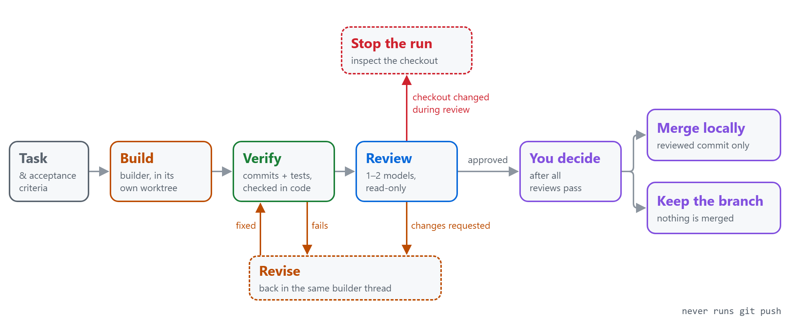

# T3 Code Workflow: Multi-Model Review Loop

[繁體中文](README.zh-TW.md)

A durable [T3 Code](https://github.com/pingdotgg/t3code) workflow for multi-model development on any Git repository. One model builds and tests in an isolated Git worktree, one or two other models review the exact verified commit, revisions return to the original builder thread, and you decide whether to merge locally or keep the branch. The workflow never pushes.

<picture>
  <source media="(prefers-color-scheme: dark)" srcset=".github/workflow-dark-en.png">
  
</picture>

## Quick start

### Requirements

- T3 Code with **Settings → Labs → Workflows** enabled
- At least two enabled providers in **Settings → Providers**
- A local Git repository registered as a T3 project, with `git` and your test tools on the T3 server's `PATH`
- Node.js 22 or newer for the CLI launcher, tested on Node.js 24
- Git 2.27 or newer, for the ref transaction used by the local merge

### Download

```sh
git clone https://github.com/RyanSparkc/t3code-workflow-review-loop.git
cd t3code-workflow-review-loop
```

### 1. Configure your models

Open [workflows/review-loop.js](workflows/review-loop.js) and fill in `AGENTS` with the provider instance IDs and model slugs shown under **Settings → Providers** in T3 Code.

You only need two entries to run, and you can add a third for parallel dual reviews. The first entry builds by default.

**Example with two models, Claude and Antigravity:**

```js
const AGENTS = {
  claude: { model: { instanceId: "claudeAgent", model: "your-claude-slug" } },
  neon: {
    model: { instanceId: "antigravity", model: "your-antigravity-slug" },
    runtimeMode: "full-access",
  },
};
```

**Example with three models, adding Codex:**

```js
const AGENTS = {
  codex: { model: { instanceId: "codex", model: "your-codex-slug" } },
  claude: { model: { instanceId: "claudeAgent", model: "your-claude-slug" } },
  neon: {
    model: { instanceId: "antigravity", model: "your-antigravity-slug" },
    runtimeMode: "full-access",
  },
};
```

Optional per-agent fields:

- `model.options`: array of provider-specific `{ id, value }` pairs for reasoning or effort levels.
- `runtimeMode`: overrides the project's default permission mode for that entry. Keep `runtimeMode: "full-access"` on Antigravity entries. Under `auto` with plan mode, Antigravity stops to ask for manual approval on read-only `git diff` commands, which stalls unattended runs. That setting applies whenever the entry runs, including when it builds.

### 2. Install into T3 Code

Copy [workflows/review-loop.js](workflows/review-loop.js) into your T3 server's workflows folder:

- **Windows PowerShell:**

  ```powershell
  Copy-Item .\workflows\review-loop.js "$env:USERPROFILE\.t3\workflows\review-loop.js"
  ```

- **macOS and Linux:**

  ```sh
  cp ./workflows/review-loop.js ~/.t3/workflows/review-loop.js
  ```

If you use a custom `T3CODE_WORKFLOWS` directory, copy the file there instead. If a `review-loop` workflow already exists, let active runs finish and back up your file before replacing it.

### 3. Verify T3 loaded it

Open **Open workflows → Definitions** in T3 Code and confirm `review-loop` is listed, or check from your terminal:

```sh
node ./scripts/review-loop-cli.mjs list
```

## Common usage

Run the launcher from this repository, or pass its full path from inside your target project with `--project .`.

### Start a standard run

**Windows PowerShell:**

```powershell
node ./scripts/review-loop-cli.mjs start --project 'C:\dev\my-app' --builder codex --task 'Add email validation and tests for valid and invalid addresses.' --test 'npm test'
```

**macOS and Linux:**

```sh
node ./scripts/review-loop-cli.mjs start --project "$HOME/dev/my-app" --builder codex --task 'Add email validation and tests for valid and invalid addresses.' --test 'npm test'
```

### Choose specific reviewers, or skip a model for one run

If you have three models configured in `AGENTS` and want to use only two for a single run, pass `--builder` and `--reviewers`:

```powershell
node ./scripts/review-loop-cli.mjs start --project 'C:\dev\my-app' --builder claude --reviewers neon --task 'Refactor the config parser.' --test 'npm test'
```

Here Claude builds, Neon covers both review areas, and Codex is never called. Unselected entries do not even need their model slugs filled in.

### Pass a multiline task file from inside your project

Put detailed requirements, constraints, and acceptance criteria into a UTF-8 file such as `task.md`, then pass `--task-file`. This avoids shell quoting issues with quotes, newlines, `>`, `&`, or `|`.

```powershell
cd C:\dev\my-app
node C:\tools\t3code-workflow-review-loop\scripts\review-loop-cli.mjs start --project . --task-file task.md --test 'npm test'
```

When handing off a chat, ask your agent to write the agreed plan and acceptance criteria into `task.md`. Reviewers receive that brief, the comparison commit SHAs, and the verification result. Your original chat stays in its own thread.

### Inspect progress and answer the merge question

You can follow runs and answer questions in T3 Code's **Workflows** page, or from the terminal. Replace `RUN_ID` with the run ID returned by `start` or `list`.

```sh
node ./scripts/review-loop-cli.mjs list
node ./scripts/review-loop-cli.mjs show --run RUN_ID
node ./scripts/review-loop-cli.mjs questions
node ./scripts/review-loop-cli.mjs merge --run RUN_ID
node ./scripts/review-loop-cli.mjs leave --run RUN_ID
```

If you do not reply within seven days, or if you choose `leave`, T3 keeps the work on its branch and leaves your target branch untouched.

## Launcher options

| Option | Behavior |
| --- | --- |
| `--task TEXT` / `--task-file FILE` | Required. Provide exactly one source for the task and acceptance criteria. |
| `--project DIR` | Required. Registered Git project root. Pass `--project .` when running from that project. |
| `--builder NAME` | Entry from `AGENTS`. Defaults to the first entry. |
| `--reviewers NAMES` | Optional comma-separated list of 1 or 2 reviewer names from `AGENTS`. Defaults to all other configured entries when `AGENTS` has 2 or 3 entries. |
| `--test COMMAND` | Runs deterministically inside the builder worktree via the server shell. Timeout is 15 minutes, and the worktree must stay clean apart from ignored files. Omit to let the builder report relevant checks for reviewers to evaluate. |
| `--base BRANCH` | Existing local target branch. Defaults to `main`. |
| `--branch BRANCH` | New worktree branch name. Generated automatically when omitted. |
| `--max-rounds N` | Integer from 1 to 5, default 3. Failed verification returns to the builder before calling reviewers. |
| `--key KEY` | Stable idempotency key. Reusing a key returns the existing run instead of starting a new one. Generated randomly when omitted. |
| `--t3 FILE` | Explicit T3 CLI path when auto-discovery fails. On Windows, accepts native `t3.exe` or a T3-generated `t3.cmd` shim. |
| `--json` | JSON output for `start`, `list`, `show`, or `questions`. |

### Windows T3 Desktop discovery

The launcher searches `PATH` and T3's standard install directories. On Windows, it reads T3 Desktop's `t3.cmd` shim as data and launches the bundled CLI directly without `cmd.exe`, preventing batch argument expansion from corrupting JSON payloads. Open T3 Desktop once so it generates its launcher. If T3 ever changes that shim format, set both environment variables `T3CODE_DESKTOP_EXE` for the Electron executable and `T3CODE_DESKTOP_ENTRY` for the bundled `bin.mjs` path.

## Safety and merge guarantees

- **Deterministic verification:** After every build and revision, the workflow checks that the expected branch exists with new commits on top of the current local base, that the worktree has no uncommitted non-ignored files, and runs `--test` directly in that worktree. On timeout, Windows stops the process tree with `taskkill /T /F` and POSIX systems kill the process group.
- **Reviewer write guard:** Reviewers open in plan mode inside the registered project checkout with read-only instructions. Because plan mode is not a filesystem sandbox, the workflow snapshots Git status, staged and unstaged diffs, the checked-out branch and commit, and both branch tips before and after every review. Any detected change stops the run before the merge question, including edits you make yourself during review. Changes inside already-untracked files or Git-ignored files are not tracked by this snapshot.
- **Strict approval rule:** A reviewer approves only by returning `approved: true` with an empty `problems` array. Any listed problem triggers a revision round, even if `approved` is `true`.
- **Atomic local merge:** When you choose `merge`, the target checkout must be on `--base` with no uncommitted tracked changes and no in-progress Git operation. The workflow creates a two-parent merge commit with `git commit-tree` using the exact verified tree and commits, honoring Git commit signing settings, and updates the branch through a Git ref transaction that locks and re-verifies both SHAs. Because this uses `git commit-tree`, repositories that depend on Git merge or commit hooks should use `leave` and merge manually. If T3 terminates mid-update, check `git status` before retrying.

## Platform verification

| Platform | Evidence for this version |
| --- | --- |
| Windows | Local test suite with 19 cases passes, covering Git worktrees, ref-transaction merges, review integrity checks, `--reviewers` filtering, Unicode and shell metacharacters, and test process tree cleanup. Verified end-to-end on T3 v0.1.12 with live models using `--builder neon --reviewers claude` while skipping `codex`, including `review-snapshot`, `review-integrity`, and atomic local merge via `review-loop-cli.mjs`. |
| macOS and Linux | Uses T3's installed executable or launcher and POSIX process-group cleanup on test timeout. Live testing on macOS and Linux is still pending. |

Run `npm test` or `node --test` to run the local test suite. The suite executes real Git operations in temporary repositories with simulated T3 workflow primitives and model replies. Because it mocks T3's `Schema` and runtime, always confirm the workflow loads in T3 after modifying `workflows/review-loop.js`.

## License

[MIT](LICENSE)
