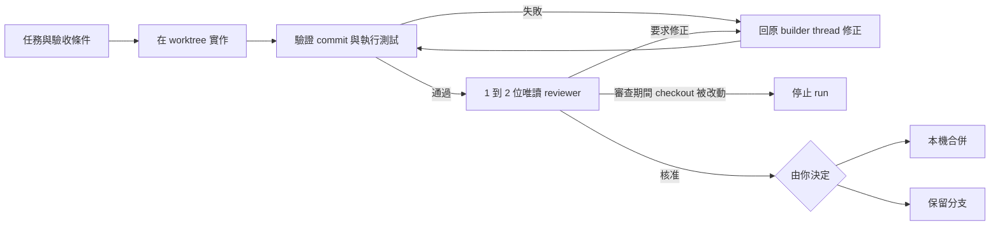

# T3 Code Workflow：多模型審查流程（Review Loop）

[English](README.md)

給 [T3 Code](https://github.com/pingdotgg/t3code) 使用的多模型開發與審查工作流程，適用於任何本機 Git 專案。由一個模型在獨立 Git worktree 實作並跑測試，再交給另外一到兩個模型審查同一個驗證過的 commit；需要修改時回到原本的 builder thread，全部通過後由你決定要本機合併或保留分支。整個流程不會執行 `git push`。



## 快速開始

### 環境需求

- 已安裝 T3 Code，並在 **Settings → Labs → Workflows** 開啟工作流程
- 在 **Settings → Providers** 啟用至少兩個 provider
- 已將目標本機 Git 專案加入 T3 專案清單，且 T3 伺服器的 `PATH` 能找到 `git` 與專案測試工具
- Node.js 22 以上（於 Node.js 24 實測），供 CLI 啟動器使用
- Git 2.27 以上，本機合併使用的 ref transaction 需要這個版本

### 下載

```sh
git clone https://github.com/RyanSparkc/t3code-workflow-review-loop.git
cd t3code-workflow-review-loop
```

### 1. 設定模型清單

打開 [workflows/review-loop.js](workflows/review-loop.js)，到 T3 Code 的 **Settings → Providers** 複製你的 provider instance ID 與 model slug，填入頂端的 `AGENTS`。

至少設定兩個項目就能執行；設定三個項目時，未當 builder 的兩台會並行分工審查。第一個項目是預設的 builder。

**兩台模型範例（例如只用 Claude 與 Antigravity）：**

```js
const AGENTS = {
  claude: { model: { instanceId: "claudeAgent", model: "你的-claude-slug" } },
  neon: {
    model: { instanceId: "antigravity", model: "你的-antigravity-slug" },
    runtimeMode: "full-access",
  },
};
```

**三台模型範例（加上 Codex）：**

```js
const AGENTS = {
  codex: { model: { instanceId: "codex", model: "你的-codex-slug" } },
  claude: { model: { instanceId: "claudeAgent", model: "你的-claude-slug" } },
  neon: {
    model: { instanceId: "antigravity", model: "你的-antigravity-slug" },
    runtimeMode: "full-access",
  },
};
```

選填的個別模型設定：

- `model.options`：各 provider 支援的 `{ id, value }` 陣列，用來指定推理強度或 effort 等級。
- `runtimeMode`：覆寫該項目的權限模式（省略時沿用專案預設）。啟用 Antigravity 時請保留 `runtimeMode: "full-access"`：在 `auto` 搭配 plan mode 時，Antigravity 執行唯讀 `git diff` 會停下來等人工核准，讓自動化流程卡住。這個設定在該項目當 builder 或 reviewer 時都會套用。

### 2. 安裝到 T3 Code

將設定好的 [workflows/review-loop.js](workflows/review-loop.js) 複製到 T3 伺服器的 workflows 目錄：

- **Windows PowerShell：**

  ```powershell
  Copy-Item .\workflows\review-loop.js "$env:USERPROFILE\.t3\workflows\review-loop.js"
  ```

- **macOS 與 Linux：**

  ```sh
  cp ./workflows/review-loop.js ~/.t3/workflows/review-loop.js
  ```

若有設定自訂環境變數 `T3CODE_WORKFLOWS`，請改複製到該目錄。若原本已有同名 `review-loop`，請先等進行中的 run 結束並備份原檔再覆蓋。

### 3. 確認載入成功

在 T3 Code 打開 **Open workflows → Definitions** 確認已出現 `review-loop`，或在終端機確認啟動器連得上 T3 伺服器：

```sh
node ./scripts/review-loop-cli.mjs list
```

## 常用啟動方式

你可以直接從這個 repo 的根目錄執行啟動器，或是切到目標專案目錄後用啟動器的完整路徑搭配 `--project .`。

### 一般啟動

**Windows PowerShell：**

```powershell
node ./scripts/review-loop-cli.mjs start --project 'C:\dev\my-app' --builder codex --task '加上 email 格式驗證，測試須涵蓋合法與非法地址。' --test 'npm test'
```

**macOS 與 Linux：**

```sh
node ./scripts/review-loop-cli.mjs start --project "$HOME/dev/my-app" --builder codex --task '加上 email 格式驗證，測試須涵蓋合法與非法地址。' --test 'npm test'
```

### 單次指定參與的模型（例如先不用 GPT）

如果 `AGENTS` 設了三台模型，但這一次只想讓 Claude 實作、Neon 審查，直接加上 `--builder` 與 `--reviewers`：

```powershell
node ./scripts/review-loop-cli.mjs start --project 'C:\dev\my-app' --builder claude --reviewers neon --task '重構設定檔解析邏輯並補上單元測試。' --test 'npm test'
```

這樣這次就只會啟動 Claude 和 Neon，Neon 會同時負責兩個審查面向，完全不會呼叫 Codex。沒被選到的項目甚至不需要填 model slug。

### 用任務檔傳入多行需求（建議用於正式任務）

需求有多行、引號，或包含 `>`、`&`、`|` 等字元時，把需求與驗收條件寫成 UTF-8 檔案（例如 `task.md`），再用 `--task-file` 傳入：

```powershell
cd C:\dev\my-app
node C:\tools\t3code-workflow-review-loop\scripts\review-loop-cli.mjs start --project . --task-file task.md --test 'npm test'
```

如果在聊天室剛和 agent 討論完需求，可以請 agent 把確認好的範圍、限制與驗收條件整理成 `task.md` 再啟動。reviewer 只會收到任務檔、比對用的 commit SHA 與驗證結果，原本的對話留在原 thread，避免審查受到討論過程影響。

### 查看進度與決定是否合併

可以直接在 T3 Code 的 **Workflows** 頁面查看與點選，也可以在終端機操作（把 `RUN_ID` 換成實際的 run ID）：

```sh
node ./scripts/review-loop-cli.mjs list
node ./scripts/review-loop-cli.mjs show --run RUN_ID
node ./scripts/review-loop-cli.mjs questions
node ./scripts/review-loop-cli.mjs merge --run RUN_ID
node ./scripts/review-loop-cli.mjs leave --run RUN_ID
```

選擇 `leave` 或七天內未回覆時，分支會保留下來，目標分支維持原樣。

## 啟動器參數

| 參數 | 說明 |
| --- | --- |
| `--task TEXT` / `--task-file FILE` | 必填，兩者擇一，提供任務說明與驗收條件。 |
| `--project DIR` | 必填，已註冊到 T3 的 Git 專案根目錄；在該專案目錄內執行時可用 `--project .`。 |
| `--builder NAME` | `AGENTS` 裡的名稱，省略時使用第一個項目。 |
| `--reviewers NAMES` | 選填，以逗號分隔指定 1 或 2 位 `AGENTS` 裡的 reviewer（例如 `--reviewers neon` 或 `--reviewers claude,codex`）。省略時自動用其他全部項目（限總數 2～3 台）。 |
| `--test COMMAND` | 由 workflow 在 builder worktree 裡透過伺服器 shell 親自執行；逾時 15 分鐘，且測試前後工作區除忽略檔案外必須乾淨。省略時由 builder 回報檢查結果，交給 reviewer 判斷。 |
| `--base BRANCH` | 既有的本機目標分支名稱，預設 `main`。 |
| `--branch BRANCH` | 新建的 worktree 分支名稱，省略時自動產生。 |
| `--max-rounds N` | 1 到 5 輪，預設 3 輪。驗證沒過會先退回 builder 修正，不浪費 reviewer。 |
| `--key KEY` | 冪等鍵，重複使用同一個 key 會取回既有 run；省略時自動產生隨機 key。 |
| `--t3 FILE` | 自動偵測不到 T3 CLI 時手動指定路徑。Windows 支援原生 `t3.exe` 與 T3 產生的 `t3.cmd`。 |
| `--json` | 讓 `start`、`list`、`show` 或 `questions` 輸出 JSON。 |

### Windows 桌面版啟動說明

啟動器會自動搜尋 `PATH` 與 T3 的標準安裝位置。在 Windows 上，啟動器會把 T3 桌面版產生的 `t3.cmd` 當純資料讀取，直接啟動內建執行檔而不經過 `cmd.exe`，避免批次檔展開字元破壞 JSON 參數。使用桌面版時請先開啟一次 T3 讓它建立 launcher；若未來 `t3.cmd` 格式改變，可直接設定環境變數 `T3CODE_DESKTOP_EXE`（T3 桌面執行檔）與 `T3CODE_DESKTOP_ENTRY`（內建的 `bin.mjs` 路徑）。

## 安全機制與合併保護

- **確定性驗證**：每輪 build 與 revise 結束後，程式會親自檢查分支是否有新 commit 且基於最新本地目標分支、worktree 沒有未提交的非忽略檔案，並在 worktree 執行 `--test`。測試逾時時，Windows 以 `taskkill /T /F` 清除整個子行程樹，macOS 與 Linux 則終止整個 POSIX 行程群組。
- **審查寫入防護**：reviewer 會在專案 checkout 以 plan mode 開啟並收到唯讀指示。由於 plan mode 本身不是檔案系統沙盒，workflow 會在每次審查前後比對 Git 狀態、暫存與未暫存 diff、目前分支與 HEAD、以及來源和目標分支 SHA；只要偵測到任何變動（包含你在審查期間手動修改工作區），就會在詢問合併前直接停止。原本就存在的未追蹤檔案內容與 Git 忽略檔案不在偵測範圍內。
- **嚴格核准條件**：reviewer 必須同時回傳 `approved: true` 且 `problems` 為空陣列才算核准；只要列了任何問題，即使 `approved` 為 `true` 也會交回 builder 修正。
- **原子本機合併**：選擇 `merge` 時，專案 checkout 必須停在 `--base`、已追蹤檔案乾淨且沒有進行中的 Git 操作。流程會用 `git commit-tree` 對驗證過的檔案樹建立雙親 merge commit（沿用 Git commit 簽署設定），再透過 Git ref transaction 鎖定目標分支並重驗兩個 SHA 後更新 checkout 與分支。因為使用 `git commit-tree`，依賴一般 merge 或 commit hooks 的專案請改用 `leave` 後手動合併；若 T3 在更新中途異常中斷，重試前請先檢查 `git status`。

## 平台驗證狀態

| 平台 | 本版驗證紀錄 |
| --- | --- |
| Windows | 本機 19 項測試全部通過，涵蓋 Git worktree、ref transaction 合併、審查前後快照比對、`--reviewers` 篩選、中文與 shell 特殊字元，以及測試逾時清理子行程樹。已在 T3 v0.1.12 完成真實模型端到端實測（`--builder neon --reviewers claude`，跳過 `codex`），涵蓋 `review-snapshot`、`review-integrity` 與 `review-loop-cli.mjs merge` 本機合併。 |
| macOS 與 Linux | 啟動器支援 T3 執行檔與安裝 launcher，測試逾時以 POSIX 行程群組清理。尚待在 macOS 與 Linux 實機驗證。 |

執行 `npm test` 或 `node --test` 可跑本機測試套件。測試會在臨時 repo 執行真正的 Git 操作，但以替代品模擬 T3 與 `Schema` 及模型輸出；修改 `workflows/review-loop.js` 後請實際載入 T3 確認。

## 授權條款

[MIT](LICENSE)
